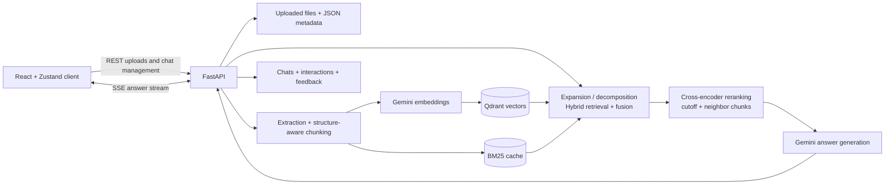

# Document Q&A Platform

A full-stack retrieval-augmented generation (RAG) application for asking grounded questions across a personal document collection. It ingests PDF, DOCX, HTML, and plain-text files; combines semantic and keyword retrieval; streams cited answers; and keeps separate, document-scoped chat histories.

The same backend can run in two modes: open access for a private single-user deployment, or JWT-authenticated multi-user access with `admin` and `client` roles.

## Why this exists

Long documents contain answers that ordinary search makes surprisingly hard to recover. A keyword search can find a page without explaining it; a general-purpose chatbot can give a fluent answer without showing whether it came from the document at all. The problem gets worse when the answer is spread across sections or across several files.

This project was built to make a document collection feel conversational without giving up provenance. You upload the material, choose what a conversation should know about, ask a normal question, and get an answer tied to the passages that produced it. Chats keep their document scope and history, so the experience is closer to working through a subject with a research assistant than repeatedly searching isolated PDFs.

The retrieval and evaluation machinery exists for the same reason. A polished answer is not useful if the system retrieved the wrong evidence. Hybrid search, reranking, citations, feedback, and repeatable evaluations are all attempts to make “show me where that came from” part of the product rather than an afterthought.

## What it does

- Processes PDF, DOCX, HTML, and TXT uploads with format and size validation.
- Preserves page or pseudo-page provenance and detects tables, lists, specifications, and section structure.
- Embeds enriched chunks with `gemini-embedding-001` and stores them in Qdrant.
- Combines Qdrant vector search with a persistent BM25 index using reciprocal-rank fusion and adaptive weighting.
- Optionally expands simple queries and decomposes multi-part questions with Gemini.
- Reranks candidates with `cross-encoder/ms-marco-MiniLM-L-6-v2`, removes duplicates/noise, and fetches useful neighbor chunks.
- Streams answers and source metadata to the React client over server-sent events (SSE).
- Supports fixed document sets or first-question automatic document routing for each chat.
- Persists chat history, retrieval traces, and per-message thumbs-up/down feedback.
- Includes an evaluation harness for retrieval, answer quality, latency, ablations, and conversational datasets.

## Architecture



### Ingestion flow

1. `POST /api/admin/upload` validates the extension, upload size, and file signature where applicable.
2. `DocumentProcessor` extracts text. PDF processing can use `pdfplumber` for table-aware Markdown extraction; DOCX files are grouped into pseudo-pages; HTML is reduced to text.
3. The default chunker uses overlap plus detected document structure. Optional semantic chunking is controlled by `USE_SEMANTIC_CHUNKING`.
4. Each chunk is enriched with its document title, page, and section before embedding.
5. Vectors and payloads are written to Qdrant, the BM25 index is rebuilt, and document metadata is saved locally.

### Question-answering flow

1. A chat either uses its selected `doc_ids`, searches all documents, or routes the first question to likely documents using BM25.
2. Gemini classifies the question and can generate alternative phrasings or split a complex question into sub-questions.
3. Vector and BM25 searches are fused; adaptive alpha selection can choose the semantic/keyword balance for the query.
4. A local cross-encoder reranks the candidates. The pipeline then deduplicates, filters noise, applies a dynamic cutoff, boosts useful structures, and adds adjacent chunks.
5. Gemini generates an answer from the assembled context and recent chat history. The API emits `retrieval_done`, `chunk`, `done`, or `error` SSE events.
6. The completed answer, sources, latency, active RAG configuration, and later user feedback are persisted for inspection.

## Technology

| Layer | Implementation |
|---|---|
| Web client | React 18, TypeScript, Vite, Zustand, React Router, Tailwind CSS |
| API | FastAPI, Pydantic, Uvicorn |
| Generation | Google Gemini (`gemini-2.5-flash` and `gemini-2.5-flash-lite`) |
| Embeddings | Google `gemini-embedding-001`, 768 dimensions by default |
| Retrieval | Qdrant, `rank-bm25`, reciprocal-rank fusion |
| Reranking | Sentence Transformers cross-encoder |
| Document parsing | PyPDF2, pdfplumber, python-docx, Beautiful Soup |
| Persistence | Qdrant plus local JSON/JSONL files; SQLite for users when auth is enabled |
| Tests | Pytest; Docker Compose test profiles |

## Repository layout

```text
.
├── backend/
│   ├── api/                 # FastAPI app, auth dependencies, schemas, routers
│   ├── src/                 # ingestion, stores, retrieval, reranking, RAG engine
│   ├── evaluation/          # datasets, metrics, reporters, evaluation CLI
│   ├── scripts/             # admin seeding and document maintenance
│   ├── tests/               # unit, integration, API, and guardrail tests
│   └── data/                # runtime uploads and local metadata (volume-mounted)
├── frontend/
│   └── src/                 # React UI, Zustand stores, typed API clients
├── docker-compose.yml       # Qdrant, API, and test profiles
├── docker-compose.prod.yml  # production-oriented Compose overrides
└── Caddyfile                # optional reverse-proxy/TLS example
```

## Local setup

### Prerequisites

- Docker with Docker Compose
- Node.js and npm
- A Google Gemini API key

The backend is Docker-first; a local Python environment is not required.

### 1. Configure the backend

From the repository root:

```bash
cp .env.example .env
```

Set `GEMINI_API_KEY` in `.env`. The remaining development defaults live in `docker-compose.yml`.

### 2. Start Qdrant and the API

```bash
docker compose up --build -d qdrant backend
docker compose ps
```

The API is available at <http://localhost:8000>, its OpenAPI UI at <http://localhost:8000/docs>, and Qdrant's dashboard at <http://localhost:6333/dashboard>.

Backend source is copied into the image rather than bind-mounted. After backend changes, rebuild and recreate it:

```bash
docker compose build backend
docker compose up -d --force-recreate backend
```

### 3. Start the web client

```bash
cd frontend
npm ci
npm run dev
```

Open <http://localhost:3000>. Vite proxies `/api` and `/health` to the backend on port 8000.

## Authentication modes

With no `JWT_SECRET`, the application runs in open/B2C mode. Requests are treated as an anonymous admin, including document-management requests. This is convenient for a private local instance but must not be exposed to an untrusted network.

To enable authenticated SaaS mode, add a random secret of at least 32 characters to `.env`:

```env
JWT_SECRET=replace-with-a-random-secret-at-least-32-characters
```

Recreate the backend, then seed an administrator:

```bash
docker exec doc-qa-backend python -m scripts.seed_admin \
  --email admin@example.com --password 'replace-this-password'
```

SaaS mode enables `/api/auth/login`, `/api/auth/refresh`, `/api/auth/me`, and `/api/auth/logout`. Access tokens are sent as Bearer tokens; refresh tokens use an HTTP-only cookie. Document mutation is admin-only, while chat ownership is scoped to the authenticated user.

## Using the API

The React application is the main client. In open mode, the underlying API can also be exercised directly.

Upload a document:

```bash
curl -X POST http://localhost:8000/api/admin/upload \
  -F 'file=@/path/to/document.pdf'
```

Ask a non-streaming question across available documents:

```bash
curl -X POST http://localhost:8000/api/query/ask \
  -H 'Content-Type: application/json' \
  -d '{"question":"What are the main conclusions?"}'
```

For conversational use, create a chat with selected document IDs (or set `auto_route` and leave `doc_ids` empty), then send questions to the chat's SSE endpoint:

```bash
curl -X POST http://localhost:8000/api/chats \
  -H 'Content-Type: application/json' \
  -d '{"name":"Research notes","doc_ids":[],"auto_route":true}'
```

| Area | Main endpoints |
|---|---|
| Documents | `POST /api/admin/upload`, `GET /api/admin/documents`, `DELETE /api/admin/documents/{doc_id}` |
| One-shot queries | `POST /api/query/ask`, `GET /api/query/documents` |
| Chats | `POST /api/chats`, `GET /api/chats/{chat_id}`, `POST /api/chats/{chat_id}/ask` |
| Chat documents | `PUT /api/chats/{chat_id}/documents`, `DELETE /api/chats/{chat_id}/documents/{doc_id}` |
| Feedback | `POST /api/chats/{chat_id}/messages/{message_id}/feedback` |
| Operations | `GET /health`, `GET /api/admin/interactions`, `GET /api/admin/feedback` |

The complete, mode-aware contract is available from the generated OpenAPI documentation.

## Configuration

The active RAG settings are centralized in `backend/src/rag_config.py` and supplied by `docker-compose.yml`.

| Variable | Default | Purpose |
|---|---:|---|
| `GEMINI_MODEL` | `gemini-2.5-flash` | Main generation model |
| `GEMINI_FAST_MODEL` | `gemini-2.5-flash-lite` | Streaming, classification, and expansion model |
| `EMBEDDING_MODEL` | `gemini-embedding-001` | Embedding provider/model |
| `EMBEDDING_DIM` | `768` | Qdrant vector size |
| `CHUNK_SIZE` / `CHUNK_OVERLAP` | `2500` / `500` | Standard chunking parameters |
| `TOP_K_RESULTS` | `12` | Initial retrieval count |
| `USE_HYBRID_SEARCH` | `true` | Combine vector and BM25 retrieval |
| `USE_ADAPTIVE_ALPHA` | `true` | Select query-specific hybrid weighting |
| `USE_RERANKING` | `true` | Enable cross-encoder reranking |
| `USE_QUERY_EXPANSION` | `true` | Generate alternative query phrasings |
| `USE_QUERY_DECOMPOSITION` | `true` | Split complex questions |
| `USE_SEMANTIC_CHUNKING` | `false` | Use embedding-based chunk boundaries |
| `MAX_UPLOAD_SIZE_MB` | `50` | Upload limit |

Changing the embedding model/dimension invalidates the existing Qdrant collection. Changing chunking settings requires documents to be processed again.

## Persistence

Runtime data is intentionally simple and inspectable:

```text
backend/data/
├── documents.json          # document metadata
├── uploads/                # original uploaded files
├── chats/                  # one JSON file per chat
├── bm25/                   # serialized keyword index
├── interactions.jsonl      # completed Q&A traces
├── feedback.jsonl          # user ratings plus retrieved chunks
└── users.db                # present only in JWT-authenticated mode

qdrant_storage/             # persisted vector collection
```

These are local files and bind mounts, not a transactional distributed data layer. Back them up together if the instance contains important documents or conversations.

## Tests and evaluation

Run the complete backend test suite through Compose:

```bash
docker compose run --rm test
```

Smaller profiles are available for faster iteration:

```bash
docker compose run --rm unit-tests
docker compose run --rm integration-tests
docker compose run --rm api-tests
```

Type-check and build the frontend:

```bash
cd frontend
npm run build
```

Run an evaluation against a checked-in dataset after the backend is running:

```bash
docker exec -t doc-qa-backend python evaluation/run_evaluation.py \
  --dataset evaluation/datasets/real_world_multi_doc.json \
  --output evaluation/results/output.json \
  --label 'local evaluation' --no-judge
```

Evaluation history is appended to `backend/evaluation/results/history.jsonl`; use `backend/evaluation/view_history.py` to inspect prior runs (the container path is `evaluation/view_history.py`).

## Operational and security notes

- Uploaded documents and questions are sent to Google APIs for embeddings and/or generation; evaluate that data flow before using sensitive material.
- There is no OCR stage. Image-only or poorly encoded scanned documents may produce little or no extractable text.
- The default open mode grants anonymous admin behavior. Enable auth before any public deployment.
- The production Compose override exposes HTTP with permissive CORS until you tighten `CORS_ORIGINS`, configure HTTPS, and enable secure cookies.
- Document/chat metadata uses local JSON files and process-level locks. This design is suitable for a small single-instance deployment, not multiple concurrent API replicas.
