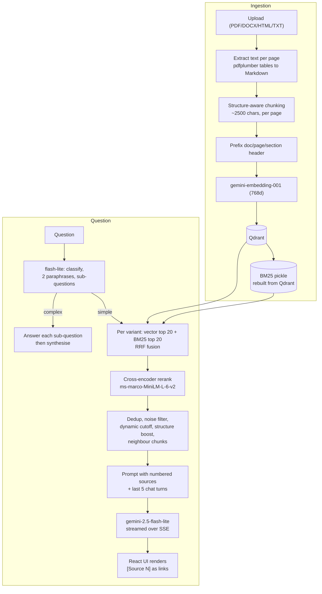

# Document Q&A Platform

A self-hosted retrieval-augmented generation (RAG) app for asking plain-language questions of long documents. Upload PDF, DOCX, HTML or TXT files, pick which documents a chat should use (or let the first question pick them), and get a streamed answer with inline `[Source N]` citations that link back to the page they came from.

It also includes an offline evaluation harness that runs benchmark question sets through the pipeline and scores the answers with an LLM judge, embedding similarity and ROUGE.

The backend runs in two modes: open single-user access (no `JWT_SECRET`), or JWT-authenticated multi-user access with `admin` and `client` roles.

## How it works



### Ingestion

1. `POST /api/admin/upload` checks extension, size and file signature, and rejects a filename that already exists.
2. `backend/src/document_processor.py` extracts text page by page. PDFs go through `pdfplumber` (tables converted to Markdown and appended to the page); PyPDF2 is used only when `USE_PDFPLUMBER` is off or pdfplumber isn't installed, not as a per-file fallback. DOCX is grouped into ~3000-char pseudo-pages. HTML and TXT are one page. There is no OCR.
3. `backend/src/chunker.py` splits each page. It detects tables, lists and headers with regexes (`structure_detector.py`), keeps those blocks whole where it can, splits prose on paragraph breaks up to `CHUNK_SIZE`, and merges tiny pieces forward. Chunks never span pages. `USE_SEMANTIC_CHUNKING=true` swaps in an embedding-similarity chunker instead.
4. Each chunk is prefixed with `[Document | Page | Section]` before embedding and keyword indexing. Each chunk is also tagged `table`, `list`, `specification`, `mixed` or `prose`.
5. Vectors go to Qdrant. The BM25 index is rebuilt from every chunk in Qdrant and pickled to disk.

### Answering

1. A chat uses its selected documents, all documents, or (with `auto_route`) the documents BM25 scores highest for the first question.
2. One `gemini-2.5-flash-lite` call labels the question simple or complex, writes two paraphrases, and for complex questions writes 2-4 sub-questions. Complex questions are answered sub-question by sub-question and then merged by a final LLM call.
3. For each query variant, Qdrant vector search and BM25 each return their top 20, fused with reciprocal-rank fusion (k=60). Variant scores are summed, with the original question weighted 2x.
4. A local cross-encoder reranks the candidates; its score is blended with the retrieval score using weights that depend on retrieval rank. Then near-duplicates and very short chunks are removed, a score-range cutoff keeps 3 to 15 chunks, chunks whose structure matches the question type (table, list, spec) get a small boost, and adjacent chunks are pulled in for structured hits.
5. The prompt lists the chunks as `Source 1..N` with document title and page, includes the last five chat turns, and asks for an exhaustive, structured answer citing `[Source N]`. The answer streams back as SSE events: `docs_routed` (optional), `retrieval_done` (with sources), `chunk`, `done` or `error`.
6. Completed chat answers (the SSE endpoint, not `/api/query/ask`), sources, latency and the active RAG config are logged to `interactions.jsonl`. Thumbs up/down feedback is stored with the answer's sources (200-char snippets with document, page and score).

## How it got here

Each stage was kept or dropped on eval results from 2026-02-01 onwards. Full reasoning in `docs/NOTES.md` section 10.

- **2026-01-21 Naive RAG** ([5a426f8](https://github.com/tarangdeep-goel-by/doc-qa-platform/commit/5a426f8)): PDF only, 1000/200 chunks, local `all-MiniLM-L6-v2`, Qdrant top-k, `gemini-2.5-flash`.
- **2026-01-22 Hybrid + rerank** ([27e66a6](https://github.com/tarangdeep-goel-by/doc-qa-platform/commit/27e66a6)): BM25 merged by weighted alpha, cross-encoder reranker, min-score guard.
- **2026-01-29 RRF + expansion** ([1ad06bc](https://github.com/tarangdeep-goel-by/doc-qa-platform/commit/1ad06bc)): RRF became the default fusion; paraphrase expansion; rank-aware rerank blending. Reranker off 01-30 after a Hugging Face timeout ([ea52f0c](https://github.com/tarangdeep-goel-by/doc-qa-platform/commit/ea52f0c)).
- **2026-02-01 Eval suite** ([496ce3e](https://github.com/tarangdeep-goel-by/doc-qa-platform/commit/496ce3e), [4614fe7](https://github.com/tarangdeep-goel-by/doc-qa-platform/commit/4614fe7)): Gemini embeddings kept (similarity scored with each side's own embedder), reranker back with a min-score fix, semantic chunking measured and left off.
- **2026-02-04 to 02-12 Judge-driven tuning** ([b273afa](https://github.com/tarangdeep-goel-by/doc-qa-platform/commit/b273afa), [068abf6](https://github.com/tarangdeep-goel-by/doc-qa-platform/commit/068abf6), [fad9326](https://github.com/tarangdeep-goel-by/doc-qa-platform/commit/fad9326)): completeness filters and prompt, 80- and 77-question sets, adaptive alpha (a no-op under RRF), weighted fusion deleted.
- **2026-02-18 Latency pass** ([764b0c8](https://github.com/tarangdeep-goel-by/doc-qa-platform/commit/764b0c8)): p50 23.2 s to 16.3 s on flash; 7.7 s in a run that, judging by run labels, answered with flash-lite (inferred, not recorded).
- **2026-02-19 Structure-aware chunking** ([ffadc1b](https://github.com/tarangdeep-goel-by/doc-qa-platform/commit/ffadc1b)): enriched headers, neighbour chunks, answers on flash-lite; 4.62/5 on 77 questions, 5.1 s p50.
- **2026-02-19 to 02-21 Auth and hardening** ([6d0ea31](https://github.com/tarangdeep-goel-by/doc-qa-platform/commit/6d0ea31), [40577bb](https://github.com/tarangdeep-goel-by/doc-qa-platform/commit/40577bb)): optional JWT, limits, deploy script.

## Technology

| Layer | Implementation |
|---|---|
| Web client | React 18, TypeScript, Vite, Zustand, React Router, Tailwind CSS, react-markdown |
| API | FastAPI, Pydantic, Uvicorn, slowapi rate limits |
| Generation | Google Gemini via `google-genai`: `gemini-2.5-flash-lite` for answers and query analysis |
| Embeddings | `gemini-embedding-001`, 768 dimensions (any sentence-transformers model also works) |
| Retrieval | Qdrant (cosine), `rank-bm25`, reciprocal-rank fusion |
| Reranking | `cross-encoder/ms-marco-MiniLM-L-6-v2` via sentence-transformers, on CPU |
| Parsing | pdfplumber, PyPDF2, python-docx, Beautiful Soup |
| Persistence | Qdrant plus local JSON/JSONL/pickle files; SQLite for users in auth mode |
| Evaluation | `gemini-2.5-flash` as judge, embedding similarity, ROUGE-L/1 |
| Tests | Pytest via Docker Compose profiles |

## Repository layout

```text
.
├── backend/
│   ├── api/                 # FastAPI app, auth, schemas, routers (admin, query, chats, auth)
│   ├── src/                 # extraction, chunking, embedder, Qdrant + BM25, reranker, qa_engine
│   ├── evaluation/          # run_evaluation.py, metrics, reporters, datasets, results/history.jsonl
│   ├── scripts/             # seed_admin, rechunk_documents, upload_and_eval
│   ├── tests/               # unit, integration and API tests
│   └── data/                # runtime uploads and metadata (bind-mounted)
├── frontend/src/            # React UI, Zustand stores, API clients, citation parser
├── docs/NOTES.md            # detailed design notes, eval history and known issues
├── docker-compose.yml       # Qdrant, backend, test profiles; all config defaults live here
├── docker-compose.prod.yml  # VPS overlay (API only)
├── deploy.sh                # VPS bootstrap script
└── Caddyfile                # example reverse proxy (not enabled)
```

## Local setup

Prerequisites: Docker with Compose, Node.js and npm, a Gemini API key.

```bash
cp .env.example .env            # set GEMINI_API_KEY
docker compose up --build -d qdrant backend
docker compose ps
```

The API is at <http://localhost:8000> (OpenAPI UI at `/docs`), Qdrant's dashboard at <http://localhost:6333/dashboard>. The first start downloads the cross-encoder from Hugging Face.

Backend code is copied into the image, not mounted. After changing it:

```bash
docker compose build backend && docker compose up -d --force-recreate backend
```

Start the web client:

```bash
cd frontend
npm ci
npm run dev
```

Open <http://localhost:3000>. Vite proxies `/api` and `/health` to port 8000.

## Authentication modes

With no `JWT_SECRET`, every request is treated as an anonymous admin. That is fine for a private local instance and unsafe on a network.

For multi-user mode, add a secret of at least 32 characters to `.env`, recreate the backend, and seed an admin:

```bash
echo 'JWT_SECRET=replace-with-a-random-secret-at-least-32-characters' >> .env
docker compose up -d --force-recreate backend
docker exec doc-qa-backend python -m scripts.seed_admin \
  --email admin@example.com --password 'replace-this-password'
```

This enables `/api/auth/login`, `/refresh`, `/me` and `/logout`. Access tokens are Bearer tokens (15 minutes); refresh tokens are HTTP-only cookies (7 days). Uploading and deleting documents is admin-only; chats belong to the user who created them. Documents are shared across all users.

## Using the API

Upload a document (open mode):

```bash
curl -X POST http://localhost:8000/api/admin/upload -F 'file=@/path/to/document.pdf'
```

One-shot question across all documents:

```bash
curl -X POST http://localhost:8000/api/query/ask \
  -H 'Content-Type: application/json' \
  -d '{"question":"What are the main conclusions?"}'
```

Create a chat that routes itself on the first question, then ask over SSE:

```bash
curl -X POST http://localhost:8000/api/chats \
  -H 'Content-Type: application/json' \
  -d '{"name":"Research notes","doc_ids":[],"auto_route":true}'

curl -N -X POST http://localhost:8000/api/chats/<chat_id>/ask \
  -H 'Content-Type: application/json' \
  -d '{"question":"Summarise the termination clauses"}'
```

| Area | Endpoints |
|---|---|
| Documents | `POST /api/admin/upload`, `GET /api/admin/documents`, `GET /api/admin/documents/{id}`, `GET /api/admin/documents/{id}/file`, `DELETE /api/admin/documents/{id}`, `POST /api/admin/documents/bulk-delete` |
| One-shot | `POST /api/query/ask`, `GET /api/query/documents` |
| Chats | `POST /api/chats`, `GET /api/chats`, `GET/PATCH/DELETE /api/chats/{id}`, `POST /api/chats/bulk-delete`, `POST /api/chats/{id}/ask` |
| Chat documents | `PUT /api/chats/{id}/documents`, `DELETE /api/chats/{id}/documents/{doc_id}` |
| Feedback | `POST /api/chats/{id}/messages/{message_id}/feedback` |
| Ops | `GET /health`, `GET /api/admin/interactions`, `GET /api/admin/feedback` |

## Configuration

Defaults are in `docker-compose.yml`. The core pipeline settings are read with no fallbacks, so the backend fails at startup if one is missing; a few ops settings (`GEMINI_FAST_MODEL`, `CORS_ORIGINS`, `COOKIE_SECURE`, `MAX_UPLOAD_SIZE_MB`, `UPLOAD_RATE_LIMIT`, `USE_PDFPLUMBER`, `LOG_LEVEL`) have code fallbacks, and `UPLOAD_RATE_LIMIT` is not set in compose at all. `.env` only needs `GEMINI_API_KEY` (and `JWT_SECRET` for auth mode).

| Variable | Default | Purpose |
|---|---:|---|
| `GEMINI_FAST_MODEL` | `gemini-2.5-flash-lite` | Answer generation, query classification/expansion, synthesis |
| `GEMINI_MODEL` | `gemini-2.5-flash` | Eval judge and eval dataset generation |
| `EMBEDDING_MODEL` / `EMBEDDING_DIM` | `gemini-embedding-001` / `768` | Embeddings and Qdrant vector size |
| `RERANKER_MODEL` | `cross-encoder/ms-marco-MiniLM-L-6-v2` | Cross-encoder |
| `USE_RERANKING` / `RERANKER_BLENDING` | `true` / `position_aware` | Rerank, blended with the retrieval score using rank-based weights (`replace` uses the cross-encoder score alone) |
| `USE_HYBRID_SEARCH` | `true` | Vector + BM25 with RRF |
| `USE_QUERY_EXPANSION` / `QUERY_EXPANSION_VARIANTS` | `true` / `2` | Paraphrase fusion |
| `USE_QUERY_DECOMPOSITION` | `true` | Split complex questions |
| `TOP_K_RESULTS` | `12` | Base retrieval size (doubled before reranking) |
| `CHUNK_SIZE` / `CHUNK_OVERLAP` | `2500` / `500` | Chunking |
| `USE_SEMANTIC_CHUNKING` | `false` | Embedding-based chunk boundaries |
| `USE_PDFPLUMBER` | `true` | Table-aware PDF extraction |
| `HYBRID_ALPHA` / `USE_ADAPTIVE_ALPHA` | `0.5` / `true` | Currently no effect: RRF ignores alpha (see Limitations) |
| `MAX_UPLOAD_SIZE_MB` | `50` | Upload limit |

Changing the embedding model or dimension needs a fresh Qdrant collection. Changing chunking needs documents re-processed: use `run_evaluation.py --reingest`, which repeats the upload path (structure-aware chunker only). `backend/scripts/rechunk_documents.py` is out of date: it skips pdfplumber, the enriched headers and the structure tags.

## Persistence

```text
backend/data/
├── documents.json      # document metadata
├── uploads/            # original files
├── chats/              # one directory per chat (metadata.json, messages.json)
├── bm25/               # pickled BM25 index
├── interactions.jsonl  # completed Q&A traces
├── feedback.jsonl      # ratings plus retrieved chunks
└── users.db            # auth mode only
qdrant_storage/         # Qdrant data
```

Local files with process-level locks. One backend instance only.

## Tests

```bash
docker compose run --rm test               # everything
docker compose run --rm unit-tests         # no external services
docker compose run --rm integration-tests  # needs Qdrant
docker compose run --rm api-tests          # needs the running backend
cd frontend && npm run build               # type-check and build the UI
```

## Evaluation

Datasets live in `backend/evaluation/datasets/`. Each question has a reference answer (`claude_answer`), mostly written by asking Claude.ai the same question with the document attached:

| Dataset | Questions |
|---|---|
| `fx5u_qa_benchmark.json` (PLC hardware manual) | 24 |
| `atomic habits.json` | 28 |
| `separation-letter.json` (employment agreement) | 28 |
| `real_world_multi_doc.json` (the three above, combined) | 77 |
| `conversational_multi_doc.json` | 6 conversations, 18 turns |
| `nvc.json` (references generated by Gemini with the full PDF) | 30 |

Upload the documents first, then run inside the backend container:

```bash
docker exec -t doc-qa-backend python evaluation/run_evaluation.py \
  --dataset evaluation/datasets/real_world_multi_doc.json \
  --label 'my change'
```

Each question goes through the live pipeline. Answers are scored by:

- an LLM judge (`gemini-2.5-flash`) giving 1-5 for relevance, completeness, accuracy and organisation against the reference answer;
- cosine similarity of answer and reference embeddings;
- ROUGE-L and ROUGE-1;
- latency percentiles.

Flags: `--no-judge` skips the judge, `--ablation` re-runs the pipeline with features switched off (it only reports retrieval metrics, so it reports zeros), `--reingest` re-chunks every stored document first, `--html` writes a report, `--compare A.json B.json` diffs two runs. Each run appends a line to `evaluation/results/history.jsonl`; `evaluation/view_history.py` prints it. `evaluation/generate_dataset.py --pdf ... --output ... --num-questions N` builds a new dataset from a PDF using Gemini.

The retrieval metrics (precision, recall, NDCG, MRR) only work when questions have `expected_sources`. None of the bundled datasets do, so those numbers are zero in every recorded run except the first three on 2026-02-01 (four FX5U questions, whose expected sources were never committed).

The most recent recorded run on the 77-question multi-doc set (2026-02-18 18:51 UTC, committed with `ffadc1b` on 02-19) scored 4.62/5 overall from the judge, 0.868 embedding similarity, 5.1 s p50 latency. See `docs/NOTES.md` for the full history and caveats.

## Limitations

- Documents, questions and answers go to Google APIs for embedding and generation.
- No OCR; scanned PDFs produce no text.
- `HYBRID_ALPHA` and adaptive alpha selection have no effect: RRF fusion ignores alpha, so adaptive selection just runs three identical searches.
- BM25 only re-ranks chunks that vector search already found; keyword-only matches outside the vector top 20 are dropped.
- With reranking on, the low-confidence guard never triggers, so the app answers whenever anything was retrieved.
- In answers built from sub-questions, `[Source N]` numbers can point at the wrong source.
- Follow-up questions are retrieved without chat history, so pronoun-heavy follow-ups can miss.
- Duplicate detection is by filename only.
- The BM25 index is rebuilt in full on every upload and delete, inside the request.
- The production overlay exposes only the API, on port 80 with open CORS and no TLS. Nothing serves the frontend in production.
- Single-instance file storage; not built for multiple API replicas.
